<p align="center">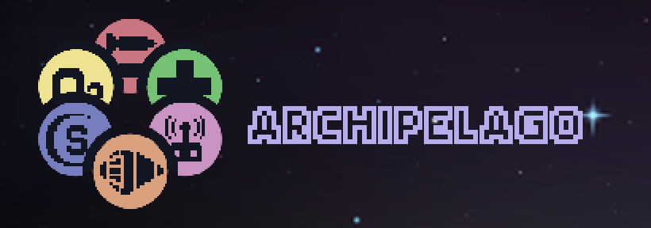</p>

<h1 align="center">FTL Archipelago</h1>

<p align="center">
<b>FTL: Faster Than Light</b> dans un multiworld <a href="https://archipelago.gg">Archipelago</a>.<br>
Vos vaisseaux, systèmes et armes sont cachés dans les parties de vos amis. Les leurs sont cachés dans la vôtre.
</p>

<h3 align="center">Pour le jeu de base et pour FTL: Multiverse <sup>bêta</sup></h3>

<p align="center">
<a href="README.md">English</a> · <b>Français</b> · <a href="README.de.md">Deutsch</a> ·
<a href="README.es.md">Español</a> · <a href="README.it.md">Italiano</a> · <a href="README.pt.md">Português</a>
</p>

<p align="center">
<a href="https://github.com/TheLiloji/FTLArchipelago/releases/latest"><b>Télécharger</b></a> ·
<a href="https://github.com/TheLiloji/FTLArchipelago/releases/tag/v0.6.0-mv.1"><b>Télécharger pour Multiverse</b></a><br>
Installation : <a href="docs/wiki/Setup-Windows.fr.md">Windows</a> · <a href="docs/wiki/Setup-Linux.fr.md">Linux</a><br>
Guides : <a href="docs/wiki/Playing.fr.md">Jouer</a> · <a href="docs/wiki/Options.fr.md">Options</a> · <a href="docs/wiki/FAQ.md">FAQ</a> · <a href="https://discord.gg/BVQnQu843Q">Discord</a>
</p>

<p align="center">Besoin d'aide ? Passez sur le <a href="https://discord.gg/BVQnQu843Q"><b>Discord</b></a>, ou ouvrez une
<a href="https://github.com/TheLiloji/FTLArchipelago/issues">issue</a> avec votre <code>FTL_HS.log</code>.</p>

> Je suis français. Cette page est écrite en français, puis traduite dans les autres langues avec l'IA.

| FTL: Faster Than Light | FTL: Multiverse <sup>bêta</sup> |
|---|---|
| 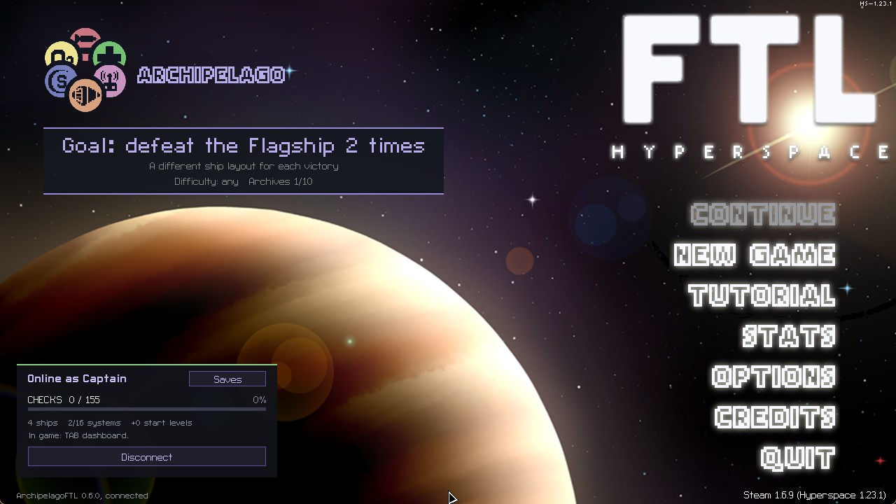 | 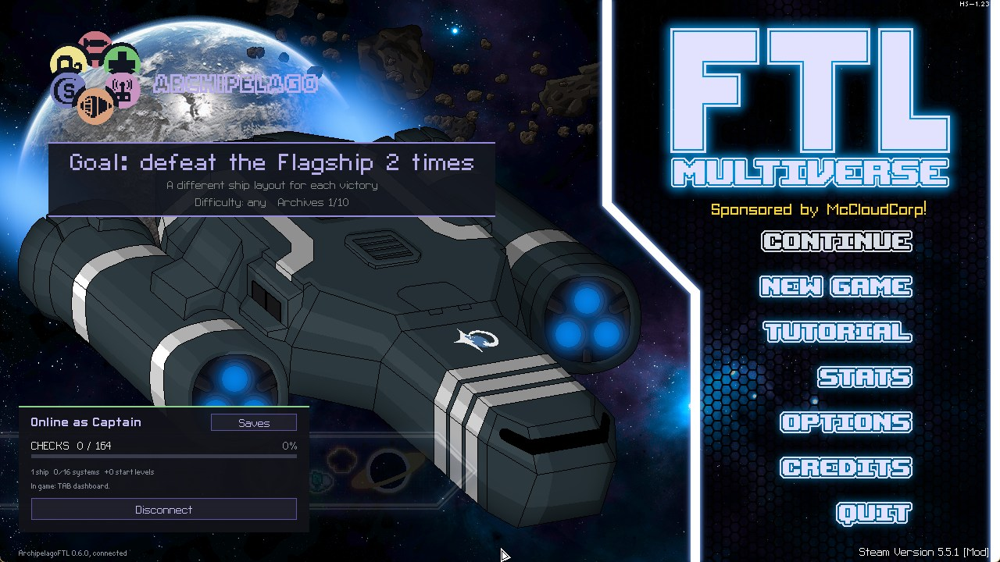 |
| 10 vaisseaux, 28 dispositions, tout le jeu de base | les 55 vaisseaux de Multiverse, le chapeau magique, les fins et les quêtes en checks. [Plus](#ftl-multiverse-bêta) |

## Comment ça se joue

Vous commencez avec un vaisseau et presque rien. Les autres vaisseaux, les systèmes, les armes, les drones, les
augmentations et l'équipage sont éparpillés dans le multiworld. Chaque partie envoie des checks à vos amis :
atteindre un secteur, gagner un combat, recruter une race, un succès, le Flagship. Ce qu'ils trouvent pour vous
arrive tout seul, et perdre une partie ne coûte que la partie.

| | |
|---|---|
| 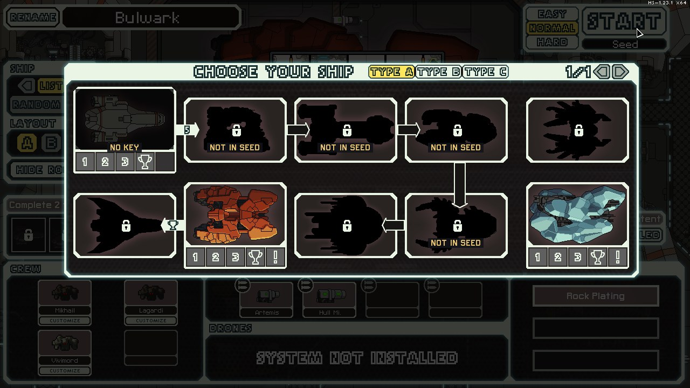 | 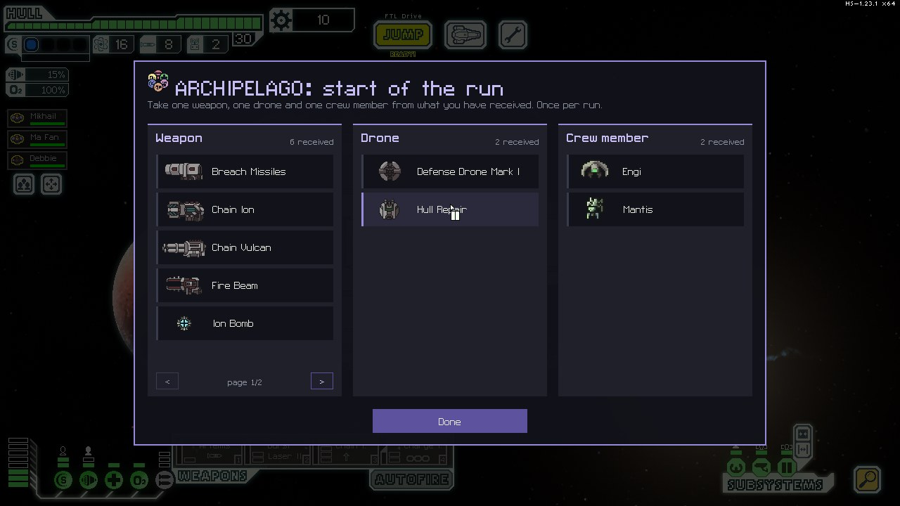 |
| 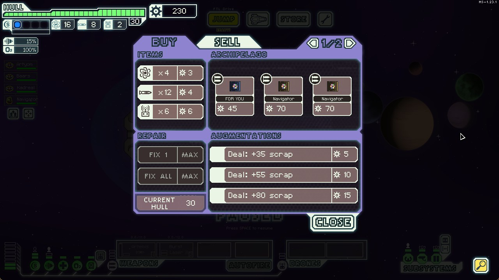 | 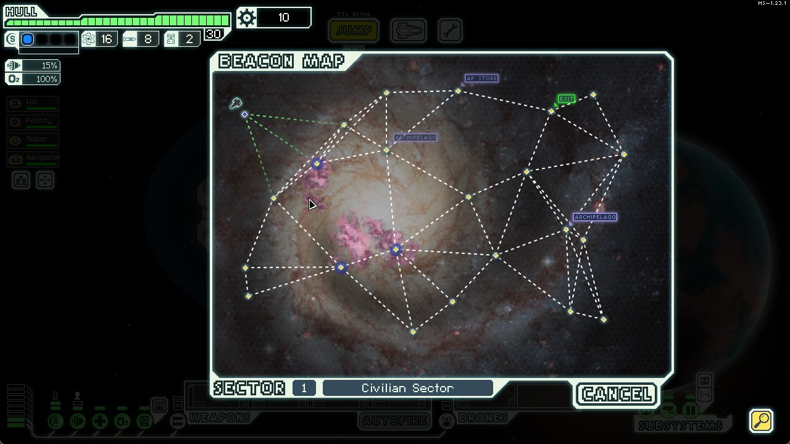 |

## Nouveau en 0.6

- **Chaque seed a sa propre sauvegarde**, et un bouton Saves pour passer de l'une à l'autre.
- **Les combats, les événements et votre réacteur** peuvent envoyer des checks.
- **Quatre nouveaux pièges** (un danger à la balise, une batterie anti-vaisseau, une surcharge du Flagship, une
  fuite d'oxygène) et **deux nouveaux événements**.
- **Sector Skip, Sector Locks, Flagship Sabotage** et d'autres options pour changer le rythme d'une partie.
- **Le tableau de bord connaît la logique** : une ligne bleue marque ce que vous pouvez déjà faire.
- Un **preset solo**, et **Multiverse** est maintenant un jeu à part.

Tous les détails dans les [notes de version](https://github.com/TheLiloji/FTLArchipelago/releases/tag/v0.6.0).

## Tout sur une touche : le tableau de bord

Appuyez sur **TAB**, en partie ou dans le hangar. Le jeu se met en pause et toute votre partie dans le multiworld
est là, d'un coup d'œil :

- **Votre objectif** et où vous en êtes.
- **Chaque check, vaisseau par vaisseau et secteur par secteur.** Une ligne bleue marque ceux que vous pouvez
  déjà faire avec ce que vous avez, pour savoir où aller ensuite.
- **Chaque item reçu**, qui vous l'a envoyé, et le contenu de chaque lot.
- **Vos indices** : ce que les autres ont trouvé pour vous, et où vos items attendent dans leurs mondes.
- **Les succès** avec leurs icônes du jeu, **les victoires** avec l'image de chaque vaisseau, **les races**
  recrutées.
- **Vos liens** : Death Link, Trap Link, et le carburant de la réserve partagée Energy Link.

| | |
|---|---|
| 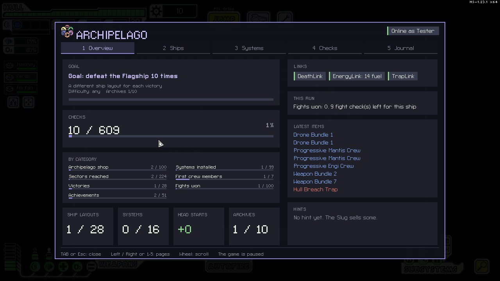 | 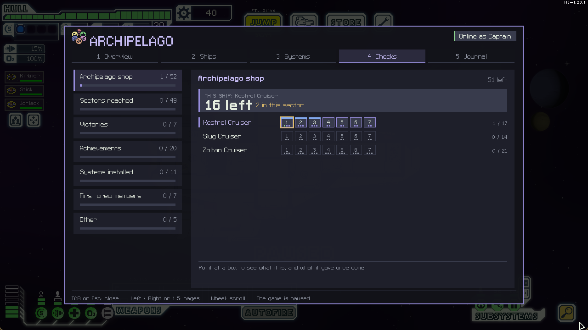 |
| 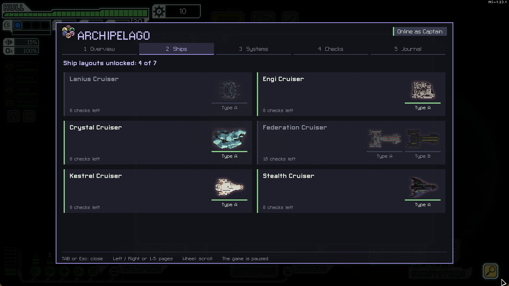 | 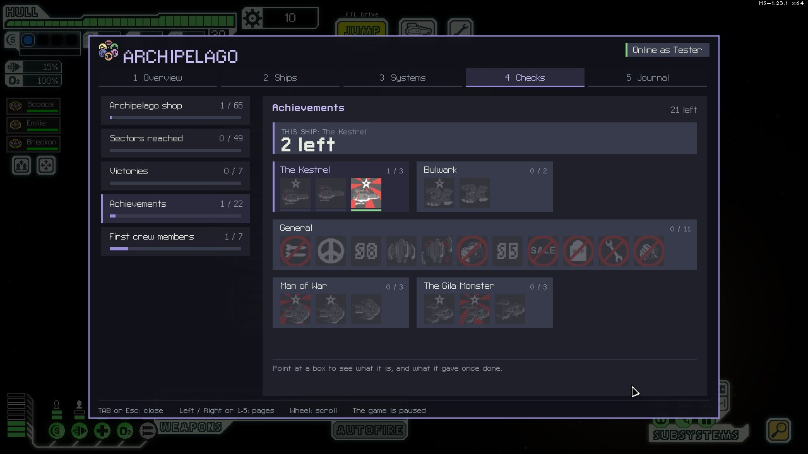 |

## Ce que vous allez croiser

Chaque secteur a un **AP STORE** qui vend des paquets pour les autres joueurs, plus des marchés et des pactes de
sang : de la ferraille tout de suite, un piège ou un membre d'équipage mort plus tard. D'autres balises cachent
des événements Archipelago : des pirates qui gardent un paquet, un Slug qui vend de vrais indices, un Engi qui
parie qu'il peut pousser votre réacteur, un marchand d'armes rare.

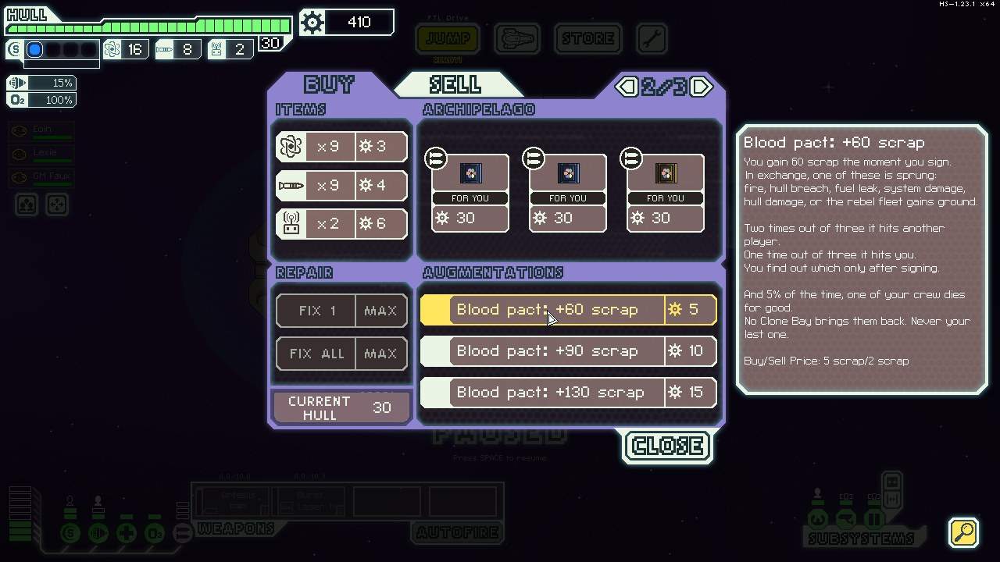

| | |
|---|---|
| 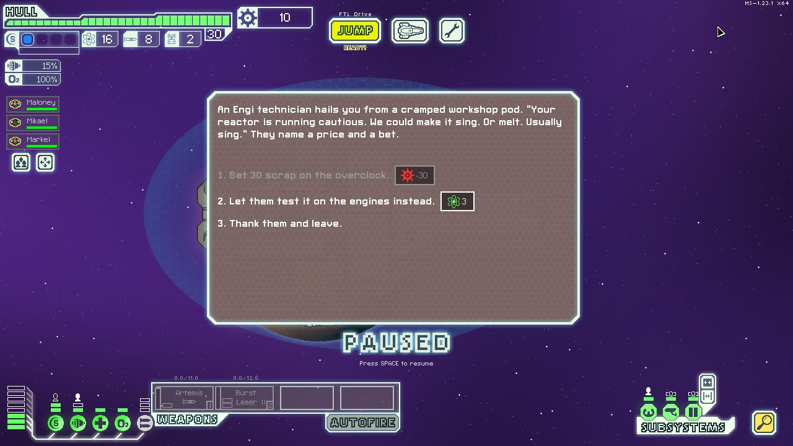 | 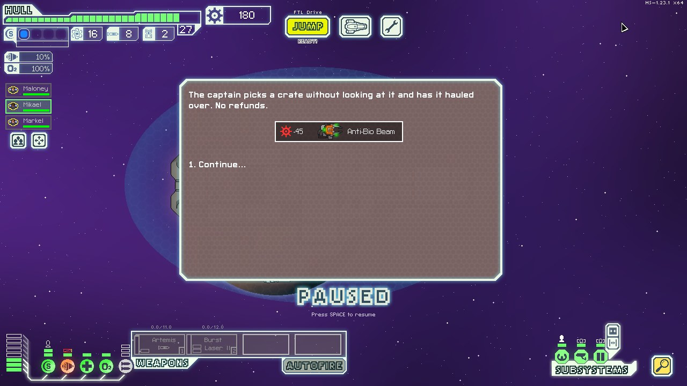 |

Avec **Sector Skip**, un secteur que vous connaissez déjà commence sur une balise de sortie : sautez tout de
suite pour de la ferraille et un choix de plus au début de la partie.

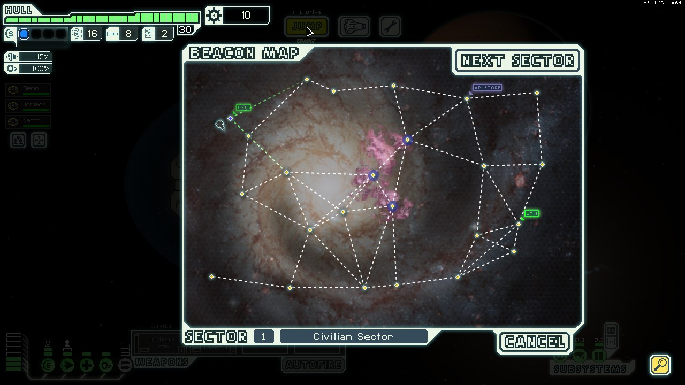

## En chiffres

| | |
|---|---|
| Vaisseaux | 10, avec 28 dispositions |
| Checks | environ 75 pour une première partie, 150 par défaut, plusieurs centaines avec tout activé |
| Options | plus de 70, et 5 presets de 3 heures à 20 heures ou plus |
| En jeu | 11 pièges, 7 événements Archipelago, un AP STORE dans chaque secteur |
| Langues | 6 |
| Avec Multiverse | 55 vaisseaux, 18 races, un chapeau magique avec 65 destinations |

Envie de chaos ? Mettez ça dans votre YAML et jouez avec des amis :

```yaml
  trap_chance: 30
  trap_link: true
  death_link: true
```

D'autres idées et toutes les options sur la [page des options](docs/wiki/Options.fr.md).

## Pour commencer

1. Prenez `ArchipelagoFTL.ftl` et la bibliothèque Hyperspace dans la
   [release](https://github.com/TheLiloji/FTLArchipelago/releases), et suivez la page d'installation pour
   [Windows](docs/wiki/Setup-Windows.fr.md) ou [Linux](docs/wiki/Setup-Linux.fr.md).
2. Faites votre YAML, ou prenez un [preset](presets). L'hôte a besoin de `ftl.apworld` et d'Archipelago 0.6.7.
3. Lancez FTL, remplissez le panneau en bas à gauche et connectez-vous. Pas de serveur ? Essayez le **mode solo**.

## FTL: Multiverse <sup>bêta</sup>

Archipelago marche aussi par-dessus **FTL: Multiverse 5.5**, comme un jeu à part, **FTL Multiverse**
(`ftl_mv.apworld` et `FTLArchipelago-MV.ftl`, sur les releases qui finissent par `-mv`). Tout le mod de base est là,
plus tous les vaisseaux de Multiverse, le chapeau magique pour aller au secteur de votre choix, les fins et les
quêtes de vaisseau en checks, et l'AP STORE dans les secteurs secrets aussi. Un vaisseau qui commence sans Oxygène
se le voit offrir.

| | |
|---|---|
| 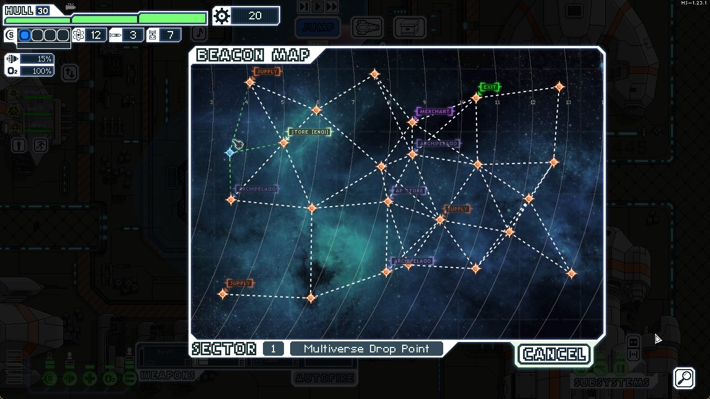 | 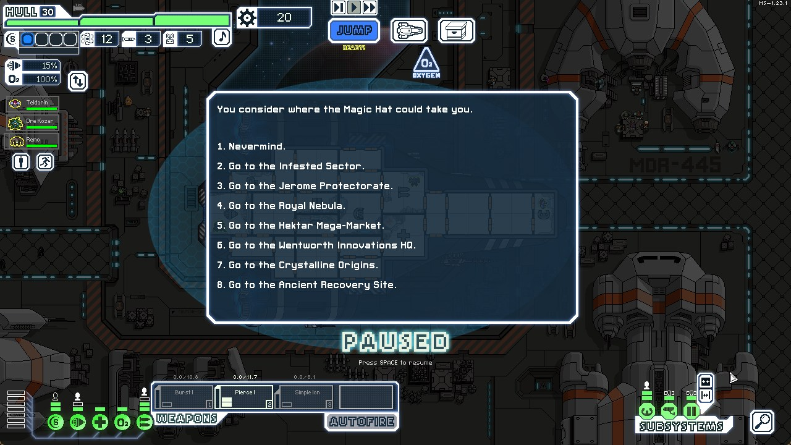 |
| 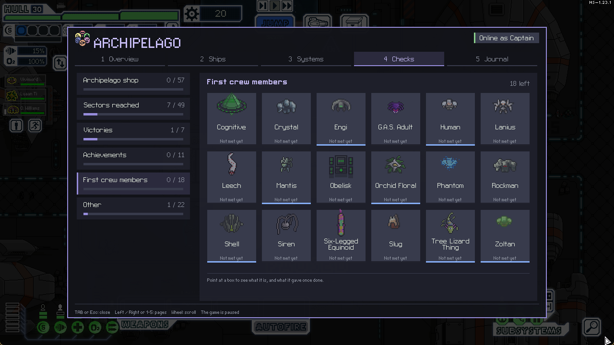 | 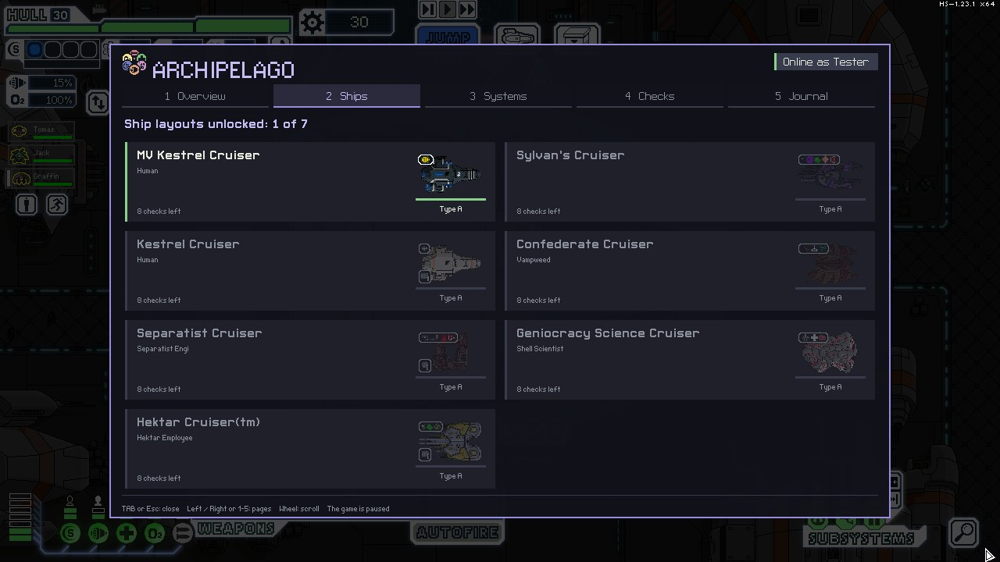 |

Installez Hyperspace, les deux zips de Multiverse (Assets puis Data), puis `FTLArchipelago-MV.ftl` en dernier dans
ftlman, et mettez `ftl_mv.apworld` dans `custom_worlds`. Plus de détails sur la
[page Multiverse](https://github.com/TheLiloji/FTLArchipelago/blob/mv-next/docs/wiki/Multiverse.fr.md).

## Utilisation de l'IA

FTL Archipelago a été fait avec l'aide de l'IA pour :

- **la bibliothèque Hyperspace** (`Hyperspace.dll` et les fichiers `.so`), qui ajoute la couche réseau pour que
  FTL parle au serveur Archipelago
- **une partie des tests**, automatiques et en parties jouées sur Linux et Windows avant chaque bêta
- **les traductions** : tout est d'abord écrit en français, puis traduit avec l'IA. L'anglais est vérifié par la
  communauté, l'allemand par Yunus et l'espagnol par Trapper444. L'italien et le portugais restent en IA, les
  corrections sont les bienvenues.

J'assume entièrement le projet et son code : je comprends comment tout fonctionne, y compris les parties où l'IA
a aidé, et je le maintiens, le débogue et l'assiste moi-même.

## Merci

**Les débuts.** Avant que ce mod existe, **File_Missing** et **eto** amenaient déjà FTL dans Archipelago avec
[FTL Multiverse Archipelago](https://github.com/Filemissing/FTLMultiverseArchipelago). File_Missing a lancé ce
projet et le Discord FTL Archipelago, et eto a fait les recherches sur l'API Hyperspace. Le
[FTL Manual](https://github.com/Et0san/Manual) d'eto a été le point de départ des items et des locations de ce
mod. Ils ont accueilli ce mod à bras ouverts quand il est arrivé. Merci à vous deux.

**Traductions et dessin.** **Trapper444** pour l'espagnol, le logo et le chapeau magique de Multiverse, d'après son
ArchiHat. **Yunus** pour l'allemand.

**Tests.** **Tom Regor**, pour tous ses tests et ses logs, les syncs qu'il organise, et des idées comme le piège
O2 Drain et le marqueur de logique. **Trapper444** et **Rhythm**, pour les tests de Multiverse et les retours sur
la logique et l'équilibrage. **ottomaatti**, qui a fait jouer une dizaine de personnes au mod pendant une LAN et m'en a fait un retour détaillé.

**Premiers testeurs.** **Cigogne** et **SynthKat67**, qui ont essuyé les plâtres dès les premiers jours (boutiques
vides, renommer un équipier qui déclenchait le Death Link), et **Astron**, présent depuis le début avec plein de
tests et de retours.

**Rapports de bugs.** **threeandthree** (TLS sous Steam Linux), **Mulac** (boutique locked), **Richard99**
(journal), **Nowi** (Death Link), **Mrs. Maple** (GOG sous Linux), **Jam** (armes ennemies trop fortes),
**Wyndrose**, **fletchy** et **Mongolico** (crashs et logs).

**Sur le Discord d'Archipelago.** **roobyroo**, pour l'accueil chaleureux et l'aide avec les règles.

**Idées et aide.** **studkid**, pour les discussions de design (logique, noms de la boutique, sauvegardes) et
l'aide aux joueurs pour l'installation. **TheLegendaryDuck** pour l'idée du piège ASB, devenu un vrai piège du mod,
et **Kholdstare** pour les idées de déblocage par secteur.

Et tout le monde sur le Discord qui joue, rejoint les syncs de test, signale des bugs et vote sur les idées : ce
mod ne serait pas ce qu'il est sans vous.

## Crédits

Le premier design des items et des locations vient du [FTL Manual d'Et0san](https://github.com/Et0san/Manual)
(MIT). Construit sur [FTL: Hyperspace](https://github.com/FTL-Hyperspace/FTL-Hyperspace) (CC-BY-SA 4.0). Voir
`apworld/ftl/LICENSE.md` et `mod/ArchipelagoFTL/CREDITS.md`.

Compiler depuis les sources et lancer les tests : [docs/BUILDING.md](docs/BUILDING.md).
