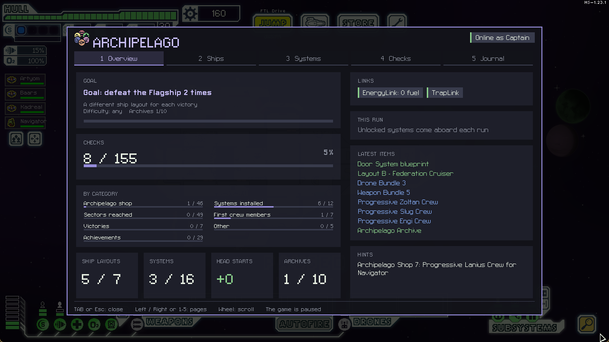

# FTL Archipelago wiki

FTL Archipelago puts **FTL: Faster Than Light** into an [Archipelago](https://archipelago.gg) multiworld. The
things FTL normally makes you unlock over many hours (ships, systems, weapons) are shuffled with the other
players' games. You get them from your friends, and you send them theirs by playing.

## Pages

- [Setup on Windows](Setup-Windows.md)
- [Setup on Linux](Setup-Linux.md)
- [Playing](Playing.md): the main menu, the hangar, the map, the shop, the dashboard and the goal
- [Options](Options.md): what to put in your YAML, and the ready-made presets
- [Multiverse](Multiverse.md): playing with FTL: Multiverse
- [Hosting a seed](Hosting-a-seed.md): generating and running a room with FTL in it
- [FAQ and problems](FAQ.md)

## FTL: Multiverse

Archipelago also runs on top of **FTL: Multiverse 5.5** as its own game, **FTL Multiverse** (`ftl_mv.apworld` and
`FTLArchipelago-MV.ftl`, on the releases named `-mv`). Everything from the base mod is there, plus all the Multiverse
ships, the Magic Hat to reroute to the sector you choose, Multiverse endings and ship quests as checks, and the
AP STORE in the secret sectors too.

| | |
|---|---|
|  |  |
|  |  |

Install Hyperspace, the two Multiverse zips (Assets, then Data), then `FTLArchipelago-MV.ftl` last in ftlman, and put
`ftl_mv.apworld` in `custom_worlds`.

## In one minute

1. Install Hyperspace and the mod with ftlman, then put this project's Hyperspace library in the game folder.
2. Start FTL, type the server address and your slot name in the panel at the bottom left, connect.
3. Start a new run. Reaching sectors, installing systems, recruiting crew, earning achievements, beating the
   Flagship and buying packages in the Archipelago shop all send checks.
4. What you receive arrives on its own: new ships in the hangar, systems you can now buy, weapons on board.
5. Win with enough different ship layouts to finish your goal.

The mod is in beta. If something looks wrong, open an issue with your `FTL_HS.log`: see [FAQ](FAQ.md).
