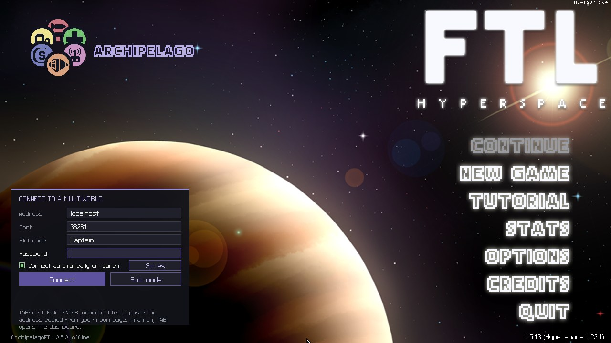
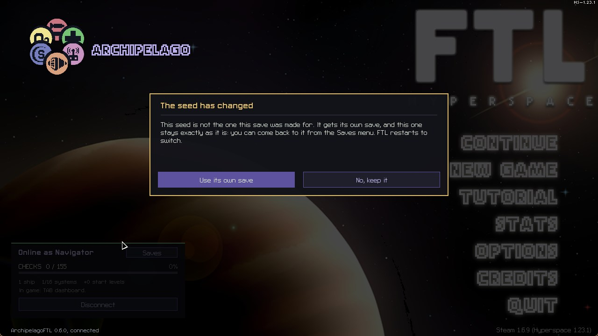
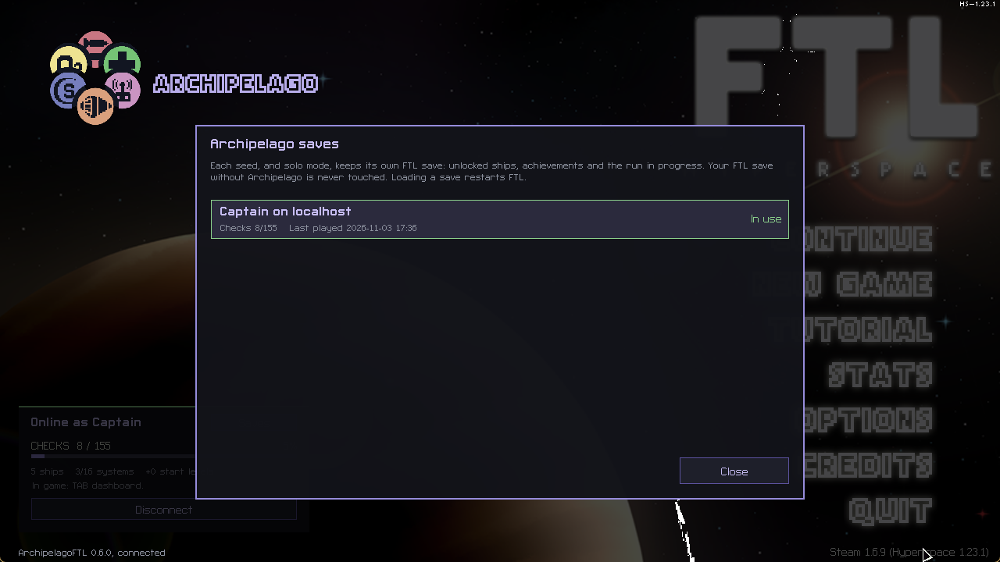
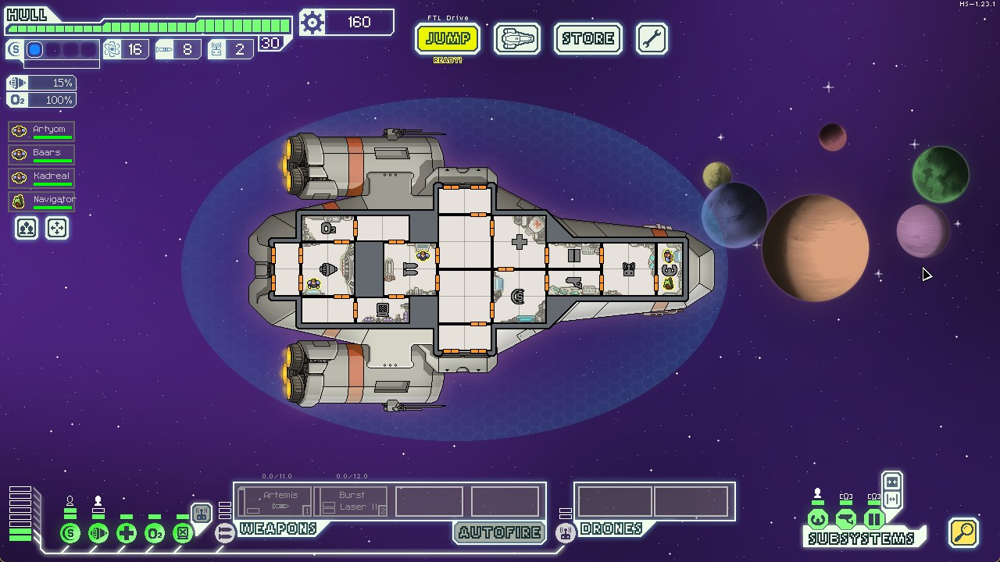
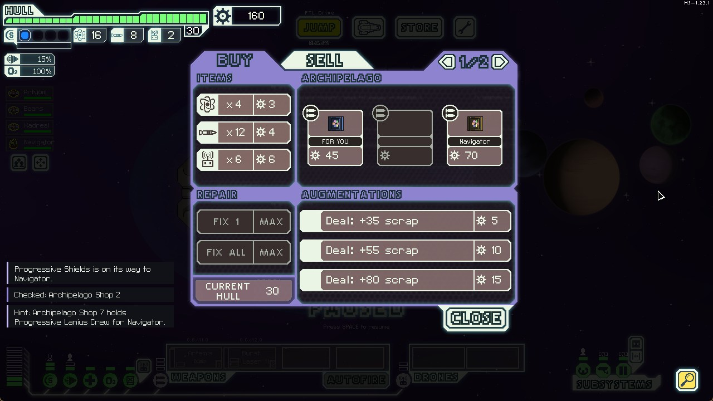
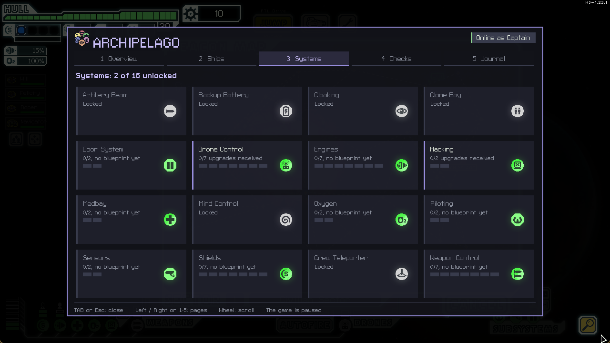
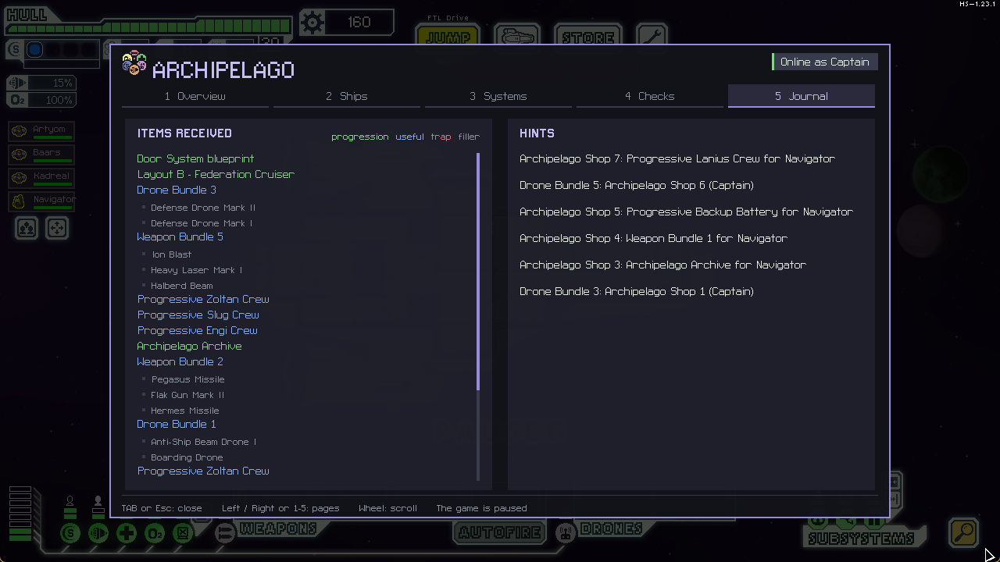

# Jugar

[English](Playing.md) · [Français](Playing.fr.md) · [Deutsch](Playing.de.md) · **Español** ·
[Italiano](Playing.it.md) · [Português](Playing.pt.md)

Esta página sigue una partida de principio a fin: la conexión, el hangar, una run, las balizas Archipelago, el
panel y el objetivo. Si el mod aún no está instalado, empieza por la guía de instalación
([Windows](Setup-Windows.es.md), [Linux](Setup-Linux.es.md)).

## Tu primera partida en cinco pasos

1. Abre FTL, rellena el panel de abajo a la izquierda del menú principal y pulsa **Connect**.
2. Responde **Use its own save** si el mod lo pregunta, para que esta seed tenga su propia partida guardada de FTL.
3. Haz clic en **Nueva partida**: el hangar se abre en tu nave inicial. Elige la dificultad que pide tu seed y
   pulsa **START**.
4. Juega como siempre. Llegar a sectores, ganar combates, reclutar tripulación y los logros envían checks. Lo que
   los demás encuentran para ti llega solo.
5. Pulsa **TAB** cuando quieras para ver tu objetivo, lo que queda por hacer y lo que has recibido.

Perder una run solo cuesta la run: guardas todo lo que has recibido, y la siguiente run empieza más fuerte.

## Conectarse

En el menú principal, rellena el panel de abajo a la izquierda:

| Campo | Qué escribir |
|---|---|
| Address | el servidor, por ejemplo `archipelago.gg`, o la IP de quien aloja |
| Port | el número después de los dos puntos en la dirección de la sala, por ejemplo `38281` |
| Slot name | el `name:` de tu YAML, exactamente como está escrito |
| Password | solo si la sala tiene una |

Pulsa **Connect** o **ENTER**. **TAB** pasa de un campo a otro. **Ctrl+V** pega la dirección copiada de la página
de tu sala (como `archipelago.gg:38281`) y rellena la dirección y el puerto de golpe.

- Los campos se guardan para la próxima vez. La contraseña, nunca.
- Marca **Connect automatically on launch** y el mod se reconecta cada vez que se abre FTL.
- Si la conexión se cae, el mod lo vuelve a intentar solo. Los checks hechos mientras tanto esperan y salen en
  cuanto vuelve la conexión.

Una vez conectado, el panel muestra tus checks y un botón **Disconnect**, y el objetivo aparece arriba:

### "The seed has changed"

FTL puede desbloquear una nave pero nunca volver a bloquearla. Por eso cada seed tiene su propia partida guardada
de FTL. Cuando entras en una seed nueva, el mod pregunta antes. **Use its own save** reinicia FTL con una partida
guardada nueva para esa seed, y la anterior se queda exactamente como estaba. **No, keep it** se queda en la
partida guardada actual, sin conexión.

El botón **Saves** del panel las lista: una por seed, más el modo solo, con los checks y la última vez que
jugaste. **Load** reinicia FTL con esa partida guardada, run en curso incluida. **Archive** aparta una partida
guardada en la carpeta `ap_profiles/archived`, no se borra nada. Tu partida guardada de FTL sin Archipelago nunca
se toca.

## El hangar

Solo se pueden elegir las naves que tienes. Las demás siguen bloqueadas hasta que llega su llave, y las naves
nuevas aparecen la próxima vez que vuelves al hangar, nunca en mitad de una run. Los layouts de tipo B y C son
objetos aparte (salvo que tu seed diga otra cosa). En la lista de naves, un layout que la seed dejó fuera está
marcado **NOT IN SEED**: nunca se desbloquea.

El hangar se abre en tu nave inicial. **RANDOM SHIP** y las flechas **< >** recorren las naves que tienes. FTL
siempre muestra el Kestrel A, aunque no pueda contar: sin su llave (opción `kestrel_key`) está marcado **NO KEY**,
y fuera de la seed **NOT IN SEED**. En una nave así, **START** está en gris y se rechaza con un motivo corto, para
que nunca empiece una run que no contaría para nada.

Pulsa **TAB** en el hangar para abrir el panel en su página de Naves: las naves con más checks pendientes van
primero, y las que no tienen nada pendiente van al final. **U** o el botón muestra u oculta las naves que no
tienes. Es una buena forma de elegir tu próxima nave.

FTL no puede desbloquear naves por su cuenta: el mod lo rechaza, y vuelve a bloquear en el menú principal una nave
que FTL desbloqueó antes. Si alguna es jugable de todas formas, está marcada **NOT RECEIVED**, y una run con ella
no cuenta para nada, ni checks ni victoria.

**¿Qué dificultad?** Por defecto solo cuentan para el objetivo las victorias en Normal y Difícil. El menú
principal y el panel dicen lo que pide tu seed. Una victoria más fácil envía igual su check de victoria.

## El menú de inicio de run

Las armas y los drones existen dos veces entre los objetos (por defecto en lotes de 3 armas o 2 drones), y los
tripulantes llegan en hasta tres pasos. En cuanto has recibido una segunda copia de algo, se abre un menú al
principio de cada run nueva: elige **un arma, un dron y un tripulante** de todo lo que has reunido, y te acompañan
en esa run.

- Con **System Install** en `run_start`, el mismo menú también ofrece los sistemas cuyo plano has recibido:
  elige los que quieras, tantos como salas libres tenga tu nave.
- Con **Sector Skip**, cada sector que te saltas da una elección más aquí.

Haz clic en **Done** para cerrarlo, o simplemente salta: el menú solo se queda hasta el primer salto. Si sales del
juego antes de elegir, sigue ahí cuando continúas. Vuelve al principio de cada run, así que una buena segunda
copia vale algo cada vez.

## Durante una run

### Lo que envía un check

Según tus opciones:

- **llegar a un sector** con un layout (la mayoría de los checks vienen de aquí);
- **vencer a la nave insignia** con un layout;
- **el primer tripulante de cada raza** que se une a ti;
- **los logros**, de la nave o generales. Salen en el salto siguiente;
- **instalar un sistema**, o cada uno de sus niveles (Systemsanity);
- **ganar combates**: los primeros de una run, o de cada sector;
- **la potencia del reactor** en 10, 15, 20 y 25;
- **comprar un paquete** en la tienda Archipelago, y los paquetes de los eventos del relé y de los piratas.

El panel (TAB) lista todos los checks de tu seed, y marca en azul los que ya puedes hacer.

### Lo que recibes

Lo que recibes llega solo, en la siguiente baliza tranquila si estás en combate:

- una **llave de nave** o un **layout**: en el hangar la próxima vez;
- un **plano de sistema**: las tiendas ya pueden vender ese sistema (o sube a bordo gratis, con System Install);
- un objeto **Progressive** de sistema: un nivel de mejora más permitido (o instalado gratis, con Free Upgrades);
- un **arma o dron**, primera copia: se pone uno a bordo (en la bodega si tus huecos están llenos; si la bodega
  también está llena, espera a que hagas sitio) y aparece más a menudo en las tiendas. Segunda copia: entra en el
  menú de inicio de run;
- un **aumento**: se pone uno a bordo y aparece más a menudo en las tiendas (si tus tres huecos están llenos,
  espera a que se libere uno);
- un **tripulante**: el primero se une a tu run (o espera un sitio libre), el segundo va al menú de inicio de run,
  el tercero convierte esa entrada del menú en un experto con una habilidad dominada;
- un **Head Start**: un nivel de sistema o una barra de reactor gratis al principio de cada run siguiente;
- un **Sector Pass** (con Sector Locks): la salida del sector 4, y luego la del 7, se abre para ese layout;
- un **Archivo**: un paso más hacia el objetivo;
- **relleno** (chatarra, combustible, misiles, piezas de dron, reparación de casco) y, si la seed tiene,
  **trampas**.

Cuando llega mucho de golpe (el release de otro jugador, el final de la partida), las armas y los drones llegan
de cuatro en cuatro por baliza; el resto sigue en los saltos siguientes.

Unas notas abajo a la izquierda te dicen qué llegó y qué salió. Se borran tras unos segundos, y todo queda en el
panel.

### Las trampas

Una trampa nunca destruye tu nave: deja al menos 3 de casco y 2 de combustible, nunca apaga del todo un sistema, y
espera a una baliza tranquila. La nota dice qué trampa es y quién la envió.

| Trampa | Qué pasa |
|---|---|
| Fire | se declara un incendio en una sala |
| Hull Breach | se abre una brecha en una sala |
| Fuel Leak | pierdes combustible |
| System Damage | un sistema recibe daño |
| Rebel Fleet | la flota rebelde avanza un salto |
| Hull Damage | tu casco pierde unos puntos |
| Boarding Party | un enemigo sube a bordo |
| O2 Drain | todas las salas pierden el aire de golpe (nunca si tu sistema de oxígeno está caído) |
| Anti-Ship Battery | espera a tu próximo combate: una batería planetaria te dispara durante él |
| Power Surge | espera a tu próximo combate: el enemigo lanza una sobrecarga de la nave insignia (más suave en los sectores 1 y 2) |
| Hazard | espera a tu próximo combate: la baliza recibe una nebulosa, una tormenta iónica, asteroides, un sol o un púlsar |

Las tres últimas se van al terminar el combate, y solo salta una por combate.

### Sector Skip y Sector Locks

Dos opciones cambian el mapa, si tu seed las tiene:

- **Sector Skip**: en los sectores 1 a 4, si este layout ya llegó al sector siguiente en una run anterior, la
  primera baliza es una salida. Salta enseguida para conseguir 60 de chatarra y una elección más en el menú de
  inicio de run, o explora como siempre. Los checks del sector saltado esperan otra run.

  

- **Sector Locks**: la salida del sector 4 sigue cerrada hasta que este layout tiene su primer Sector Pass, y la
  del sector 7 hasta el segundo. La baliza de salida dice lo que falta, y se abre en cuanto llega el pase.

### La nave insignia

Con **Flagship Sabotage**, un mensaje te avisa cuando la nave insignia llega debilitada, y cuánto (casco,
escudos, armas). La victoria sale en cuanto la nave insignia queda destruida.

## Las balizas Archipelago

Cada sector tiene una baliza marcada **AP STORE**, con la tienda Archipelago, y otras balizas esconden los
eventos propios del mod. Por defecto solo las dos que llevan un paquete (el relé y los piratas) están marcadas
**ARCHIPELAGO** en el mapa; la opción **Event Beacons** puede marcarlas todas o ninguna.

### La tienda Archipelago

Cada paquete es un objeto del multiworld. El nombre de debajo dice para quién es; **FOR YOU** quiere decir uno de
tus propios objetos. Comprar un paquete lo envía enseguida:

El relleno cuesta de 10 a 25 de chatarra, los objetos útiles de 30 a 65, y los importantes de 70 a 150. Un paquete
enviado nunca vuelve. Cada sector vende sus propios paquetes: la tienda del sector 5 tiene otros paquetes que la
del sector 2, y cuestan más. Con **Archipelago Shop by Sector**, un paquete solo se vende en su sector, y la
tienda dice en qué sector están los siguientes.

Por defecto, los paquetes que ves se vuelven pistas para sus dueños: saben dónde espera su objeto.

La tienda también vende **pactos**: chatarra enseguida, y a cambio salta una trampa, dos veces de cada tres sobre
otro jugador (con Trap Link), una vez de cada tres sobre ti. Sin Trap Link, siempre sobre ti. Cuando es sobre ti,
golpea en tu próximo combate, no en la baliza tranquila de la tienda. Los **pactos de sangre** de la segunda página
pagan más, y añaden una probabilidad (5, 10 o 20 %) de que uno de tus tripulantes muera para siempre, con bahía
de clonación o sin ella. Nunca se llevan a tu último tripulante.

### Los eventos

- **Un relé** que lleva paquetes para otros jugadores. Paga 15 de chatarra para reenviar uno.
- **Piratas con un paquete**, a menudo el de un amigo. Págales 20 de chatarra, o lucha contra ellos y envíalo
  gratis si ganas.
- **Un control zoltan** que vende 3 de combustible por 15 de chatarra. Con Energy Link cuesta 20 y añade 1 de
  combustible a la reserva compartida, o puedes sacar combustible de la reserva en su lugar.
- **Un Slug** que vende una pista real de Archipelago por 20 de chatarra. Si no queda nada que señalar, te
  devuelve la chatarra.
- **Una sobretensión de otro mundo**, que puedes absorber o reenviar como trampa (con Trap Link).
- **Un técnico engi** (sectores engi y civiles) que apuesta 30 de chatarra a que puede overclockear tu reactor.
  Paga 75 de chatarra si aguanta, y cuesta daño al casco y a los motores si no. También puedes dejarle probar los
  motores por 3 de combustible, o simplemente irte.
- **Un traficante de armas**, raro, en sectores piratas: un arma al azar por 45 de chatarra, o un aumento al azar
  por 4 de combustible.

| | |
|---|---|
|  |  |

Con **Archipelago Event Checks**, los paquetes del relé y de los piratas son checks propios ("Archipelago Event 1",
2...) antes de volver a vender los paquetes de la tienda. Ninguno de estos eventos puede esconderte un check: son
un extra, nunca obligatorios.

## Jugar con otros: los enlaces

Solo funcionan si tu YAML los activó. La primera página del panel muestra cuáles están activos.

- **Death Link**: cuando mueres, los demás mueren también, y al revés. Tu seed dice qué cuenta como tu muerte (una
  run perdida, un tripulante perdido, o las dos). Una muerte recibida hace algo malo (por defecto una brecha y un
  incendio en una sala de sistema) pero nunca destruye tu nave ni mata a tu último tripulante. Haz clic en Death
  Link en la primera página del panel para apagarlo o encenderlo, si tu seed lo permite.
- **Energy Link**: una reserva de combustible compartida con todos los jugadores de Energy Link. Tu combustible de
  sobra entra en las balizas tranquilas (se pierde un 25 % por el camino), y cuando bajas de 3 de combustible tu
  nave saca un poco, una vez por baliza. El panel muestra cuánto hay en la reserva.
- **Trap Link**: cuando alguien recibe una trampa, los demás reciben otra. Una trampa de otro juego se convierte
  en la trampa de FTL más parecida ("Ice Trap" apaga un sistema, una trampa de fuego enciende un incendio...).

## El panel

Pulsa **TAB** en una run o en el hangar. En una run el juego se pausa mientras está abierto. **Izquierda** /
**Derecha** o **1** a **5** cambian de página, la rueda del ratón desplaza, **Esc** o **TAB** lo cierra.

| | |
|---|---|
|  |  |
| **1 Resumen**: tu objetivo y cómo vas, los checks hechos por categoría, tus enlaces (Death Link, Energy Link, Trap Link), esta run (combates que quedan con check, chatarra para la siguiente run, mejoras gratis), los últimos objetos recibidos y tus pistas. | **2 Naves**: cada layout de la seed, tuyo o no, y cuántos checks le quedan. **U** muestra solo los que tienes. |
|  |  |
| **3 Sistemas**: qué planos tienes, cuántos niveles de mejora has recibido para cada sistema, y los Head Starts que se dan al principio de cada run. | **4 Checks**: todos los checks de la seed, por categoría y nave por nave. Hechos en verde, y una **línea azul** bajo los que ya puedes hacer con lo que tienes. Pasa el ratón por una casilla para ver qué es, y qué dio una vez hecha. |

**5 Diario**: cada objeto recibido, quién lo envió, y qué había en cada lote, coloreado según su clase de
Archipelago (progresión verde, útil azul, trampa roja, relleno gris). A la derecha, tus pistas: lo que los demás
encontraron para ti, y dónde esperan tus objetos en sus mundos. Una pista se queda ahí hasta que se encuentra el
objeto.

La página de Checks también tiene los logros con sus iconos del juego, las victorias con la imagen de cada nave, y
las razas de tripulación que has reclutado.

**¿Adónde ir ahora?** Abre la página de Checks y busca las líneas azules en la nave que pilotas. En la página de
Naves, las que tienen más checks pendientes van primero.

## El objetivo

Vence a la nave insignia con un número de naves (o layouts) **distintos**. El menú principal y el panel lo dicen
completo, por ejemplo "derrota a la nave insignia 2 veces, un layout distinto para cada victoria", y listan las
naves con las que ya has ganado. Una segunda victoria con la misma nave envía igual su check de victoria, solo que
no cuenta otra vez para el objetivo.

Algunas seeds piden también **Archivos**: objetos repartidos por el multiworld, también en tu propio mundo.
Necesitas las victorias y suficientes Archivos. El objetivo sale solo en cuanto tienes las dos cosas, aunque el
último Archivo llegue mientras estás en el menú.

Algunas seeds piden victorias en Normal o Difícil. Una victoria más fácil envía igual su check, pero no cuenta
para el objetivo.

## Modo solo

¿Sin servidor? Haz clic en **Solo mode** en el panel de conexión. Usa una seed real generada y te da uno de sus
objetos por check. Siempre es la misma seed de demostración que viene con el mod, no tu YAML, así que tus opciones
no se aplican. Tu progreso se guarda en su propia partida guardada, así que puedes parar y volver más tarde.
**Stop solo** la aparta, y volver a hacer clic en **Solo mode** pregunta si seguir o empezar de cero.

## Bueno saberlo

- **Perder una run solo cuesta la run.** Los objetos se quedan, y los Head Starts hacen más fuerte la siguiente
  run.
- **Una run empezada antes de conectarte no cuenta.** Conéctate primero, luego empieza una partida nueva. Lo mismo
  para una run guardada con otra seed: "Continuar" la recupera, pero no cuenta para nada, y la chatarra, el
  combustible y las trampas que recibes mientras tanto esperan a tu próxima run de verdad.
- **Volver a una seed que ya jugaste** no reparte su chatarra, su combustible y sus trampas una segunda vez. Las
  naves, los planos y los niveles de mejora vuelven como estaban.
- **Los checks de logros salen en el salto siguiente**, y los logros ganados antes de Archipelago no cuentan:
  vuelve a ganarlos.
- **"Llegar al sector 1" necesita un salto.** Un check sale cuando llegas a algún sitio.
- **Las trampas recibidas nunca destruyen tu nave.** Dejan al menos 3 de casco y 2 de combustible, y esperan a una
  baliza tranquila.
- **Las muertes recibidas** (Death Link) nunca se llevan tu último punto de casco ni tu último tripulante.
- **Envías una muerte** (Death Link) cuando pierdes la run o un tripulante, según las opciones de la seed. Un
  tripulante que la bahía de clonación trae de vuelta no es una muerte, salvo que la seed los cuente. Despedir a
  un tripulante desde la pantalla de tripulación, o perder un dron, no cuenta.
- **Los nombres de objetos y lugares se quedan en inglés** sea cual sea el idioma, porque todos los jugadores y
  trackers los comparten. Solo se traducen las frases de alrededor.

## Si algo no funciona

Mira primero las [FAQ](FAQ.md) (en inglés). Si no ayudan, pregunta en el [Discord](https://discord.gg/BVQnQu843Q)
o abre un [issue](https://github.com/TheLiloji/FTLArchipelago/issues) con tu `FTL_HS.log` (en la carpeta de FTL
en Windows, en su carpeta `data` en Linux).
